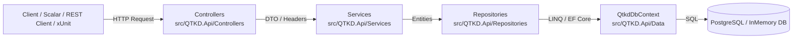

# HỆ THỐNG QUẢN TRỊ KINH DOANH (QTKD) — TUẦN 05, 06 & 07

- **Môn học:** Phát triển ứng dụng Hệ thống Thông tin Hiện đại
- **Công nghệ sử dụng:** .NET 10 (ASP.NET Core Web API), Entity Framework Core 10, PostgreSQL (Npgsql), Scalar API Reference, xUnit, FluentAssertions, Moq.

---

## 1. Cấu trúc Repository & Kiến trúc hệ thống

Repository được tổ chức và phát triển xuyên suốt 3 tuần thực hành theo đúng cấu trúc chuẩn quy định: `src/` (mã nguồn ứng dụng), `tests/` (kiểm thử tự động), `docs/` (tài liệu thiết kế/API/minh chứng) và `README.md`:

```text
QTKD/
├── QTKD.slnx                              # Solution file (.NET 10 format)
├── README.md                              # Hướng dẫn cài đặt, chạy dự án & báo cáo kiểm thử
├── src/                                   # [Mã nguồn ứng dụng Web API]
│   └── QTKD.Api/                          # Project Web API (Kiến trúc 3 tầng chuẩn)
│       ├── Controllers/                   # Tầng API: Customers, Contracts, PriceLists
│       ├── Services/                      # Tầng Nghiệp vụ: Kiểm tra CTR-01..03 & US03
│       ├── Repositories/                  # Tầng Truy cập dữ liệu (EF Core Repositories)
│       ├── Data/                          # QtkdDbContext & Seed Data mẫu
│       ├── Models/                        # Domain Entities: Customer, Contract, PriceList, PriceItem
│       ├── DTOs/                          # Request & Response DTOs
│       ├── Migrations/                    # EF Core Migrations (InitialCreate & US03)
│       ├── appsettings.Development.json   # Cấu hình chuỗi kết nối PostgreSQL
│       ├── Program.cs                     # Cấu hình DI, Middleware & Database Provider
│       └── QTKD.Api.http                  # Kịch bản kiểm thử trực tiếp API qua REST Client
├── tests/                                 # [Kiểm thử tự động - xUnit (Tuần 07)]
│   ├── QTKD.Tests.csproj                  # Project xUnit Test (.NET 10)
│   ├── TestResults/                       # Thư mục lưu kết quả kiểm thử (.trx)
│   │   └── test_results.trx               # Kết quả thực thi kiểm thử chuẩn Visual Studio Test
│   ├── UnitTests/                         # Kiểm thử đơn vị (Service & Quy tắc CTR-01..03, Moq Repository)
│   │   ├── CustomerServiceTests.cs        # 5 tests: Tạo mới, cập nhật, validation dữ liệu khách hàng
│   │   ├── ContractServiceTests.cs        # 13 tests: CTR-01, CTR-02, CTR-03, US03 & Chống gửi lặp
│   │   └── PriceListServiceTests.cs       # 5 tests: Bảng giá, đơn giá > 0, tính toàn vẹn khóa ngoại
│   └── IntegrationTests/                  # Kiểm thử tích hợp (API Endpoints & In-Memory Database)
│       ├── CustomWebApplicationFactory.cs # WebApplicationFactory giả lập API & In-Memory DB cô lập
│       ├── CustomerApiTests.cs            # 7 tests: POST, GET, PUT /api/customers & đọc lại từ DB
│       └── ContractApiTests.cs            # 13 tests: Đầy đủ TC01..TC08 & Luồng liên hoàn End-to-End
└── docs/                                  # [Tài liệu Thiết kế, Đặc tả API]
    └── API_AND_BUSINESS_RULES.md          # Chi tiết API, mẫu Request/Response JSON & đối chiếu nghiệp vụ
```

### Sơ đồ luồng xử lý 3 tầng:



---

## 2. Hướng dẫn Cài đặt, Cấu hình & Khởi động Dự án

### 2.1. Chuẩn bị môi trường

- .NET 10 SDK.
- Công cụ Entity Framework Core CLI: `dotnet tool install --global dotnet-ef` (nếu máy chưa cài).
- Hệ quản trị CSDL PostgreSQL (phiên bản 14 trở lên đang chạy ngầm trên máy).

### 2.2. Cấu hình chuỗi kết nối (`src/QTKD.Api/appsettings.Development.json`)

```json
{
  "ConnectionStrings": {
    "DefaultConnection": "Host=localhost;Port=5432;Database=QTKD;Username=postgres;Password=admin"
  }
}
```

_(Tùy chỉnh `Username` và `Password` phù hợp với tài khoản PostgreSQL trên máy của bạn)._

### 2.3. Khôi phục thư viện và Cập nhật Database (Migration)

Từ thư mục gốc `QTKD`, mở Terminal và chạy lần lượt:

```powershell
# 1. Khôi phục toàn bộ package NuGet cho Solution
dotnet restore

# 2. Cập nhật cấu trúc database và nạp dữ liệu mẫu
dotnet ef database update --project src/QTKD.Api
```

### 2.4. Khởi động Web API

```powershell
dotnet run --project src/QTKD.Api
```

- Địa chỉ API: `http://localhost:5211`
- Giao diện tài liệu tương tác trực quan (**Scalar API Reference**): **`http://localhost:5211/scalar/v1`**

---

## 3. Tóm tắt API & Đối chiếu Quy tắc Nghiệp vụ

> 📄 **Tài liệu chi tiết:** Xem đầy đủ mẫu Request/Response JSON, giả định thiết kế và giải thích chi tiết tại [`docs/API_AND_BUSINESS_RULES.md`](docs/API_AND_BUSINESS_RULES.md).

### 3.1. Danh sách Endpoint chính

| Phân hệ             | Phương thức & Endpoint                                                                                                                                 | Chức năng & Kiểm tra nghiệp vụ                                                                                                                                          |
| :------------------ | :----------------------------------------------------------------------------------------------------------------------------------------------------- | :---------------------------------------------------------------------------------------------------------------------------------------------------------------------- |
| **Customer**        | `GET /api/customers`<br>`GET /api/customers/{id}`<br>`POST /api/customers`<br>`PUT /api/customers/{id}`                                                | Xem danh sách, xem chi tiết, tạo mới và cập nhật khách hàng.<br>Kiểm tra `Name` bắt buộc, `Status` hợp lệ (`Active` / `Inactive`).                                      |
| **Contract & US03** | `GET /api/contracts`<br>`GET /api/contracts/{id}`<br>`POST /api/contracts`<br>`PUT /api/contracts/{id}`<br>**`POST /api/contracts/{id}/submit`**       | Quản lý hợp đồng và **Gửi hợp đồng trình duyệt (US03)**.<br>Kiểm tra ngày hiệu lực, trạng thái và các quy tắc **CTR-01, CTR-02, CTR-03**, **AC01..AC05**.               |
| **Pricing**         | `GET /api/pricelists`<br>`GET /api/pricelists/{id}`<br>`POST /api/pricelists`<br>`GET /api/pricelists/{id}/items`<br>`POST /api/pricelists/{id}/items` | Tạo/xem bảng giá (`PriceList`) và thêm/xem đơn giá dịch vụ (`PriceItem`).<br>Kiểm tra liên kết `PriceListId` tồn tại, `ServiceCode` không trùng và **`UnitPrice > 0`**. |

### 3.2. Bảng đối chiếu nhanh US03 & Quy tắc CTR-01..03

|         Mã          | Ý nghĩa nghiệp vụ                                                                                                                                   | Đoạn xử lý trong mã nguồn                                                                               | Cách kiểm tra & Kết quả                                                                                                           |
| :-----------------: | :-------------------------------------------------------------------------------------------------------------------------------------------------- | :------------------------------------------------------------------------------------------------------ | :-------------------------------------------------------------------------------------------------------------------------------- |
|     **CTR-01**      | Chỉ cho sửa hợp đồng ở `Draft` hoặc `RevisionRequested`                                                                                             | [`ContractService.UpdateAsync`](src/QTKD.Api/Services/ContractService.cs)                               | Sửa hợp đồng đang ở `PendingApproval` $\rightarrow$ Bị từ chối `409 Conflict` (`CTR01_EDIT_NOT_ALLOWED`).                         |
|     **CTR-02**      | Chỉ gửi duyệt khi `Customer` (`Active`), ngày hiệu lực (`StartDate <= EndDate`), nội dung (`ServiceGroup`) và tệp bắt buộc (`AttachmentUrl`) hợp lệ | [`ContractService.SubmitAsync`](src/QTKD.Api/Services/ContractService.cs)                               | Thiếu 1 điều kiện $\rightarrow$ Trả `400 Bad Request` (`CTR02_VALIDATION_FAILED`) kèm danh sách lỗi chi tiết, giữ nguyên `Draft`. |
|     **CTR-03**      | Không được chuyển `Draft` thẳng sang `Approved`                                                                                                     | [`ContractService.CreateAsync`](src/QTKD.Api/Services/ContractService.cs), `UpdateAsync`, `SubmitAsync` | Chặn truyền `Status = "Approved"` (`400`); `Submit` thành công chỉ chuyển sang `PendingApproval`.                                 |
| **US03 (AC01..05)** | Kiểm tra quyền (`403`), trạng thái (`409`), điều kiện `CTR-02` (`400`), sinh `approvalId` (`200`) và chống gửi lặp 2 lần (`Idempotency-Key`)        | [`ContractService.SubmitAsync`](src/QTKD.Api/Services/ContractService.cs)                               | Gửi lần 2 cùng `Idempotency-Key` trả lại đúng `approvalId` cũ (`200 OK`); gửi lần 2 không khóa trả `409 Conflict`.                |

---

## 4. Hướng dẫn chạy Kịch bản Demo Nghiệp vụ (Tuần 06)

Mở file [`src/QTKD.Api/QTKD.Api.http`](src/QTKD.Api/QTKD.Api.http) (hoặc giao diện Scalar tại `http://localhost:5211/scalar/v1`) và thực hiện theo thứ tự:

1. **Tạo Customer** (`POST /api/customers`).
2. **Tạo Contract Draft thiếu dữ liệu** (`POST /api/contracts` với `serviceGroup: null`, `attachmentUrl: null`).
3. **Gửi trình duyệt khi thiếu dữ liệu** (`POST /api/contracts/{id}/submit`) $\rightarrow$ Thất bại `400 Bad Request` (vi phạm `CTR-02`).
4. **Bổ sung dữ liệu còn thiếu** (`PUT /api/contracts/{id}` với đầy đủ `serviceGroup` và `attachmentUrl`).
5. **Gửi trình duyệt lại** (`POST /api/contracts/{id}/submit`) $\rightarrow$ Thành công `200 OK`, chuyển sang `PendingApproval` kèm mã `approvalId`.
6. **Thử gửi lần 2 & Thử sửa khi `PendingApproval`** $\rightarrow$ Kiểm chứng chống gửi lặp (`AC05`) và chặn sửa (`CTR-01`).
7. **Kiểm tra trạng thái trong PostgreSQL:**
   ```sql
   SELECT "Id", "ContractNo", "CustomerId", "Status", "ServiceGroup", "AttachmentUrl", "ApprovalId", "SubmittedAt"
   FROM "Contracts";
   ```

---

## 5. Báo cáo & Hướng dẫn Kiểm thử Tự động (Tuần 07)

Dự án kiểm thử tự động được đặt tại thư mục `tests/`, tách biệt rõ ràng 2 tầng kiểm thử:

- **Unit Tests:** Kiểm tra logic nghiệp vụ tại tầng Service (`CustomerServiceTests`, `ContractServiceTests`, `PriceListServiceTests`) sử dụng thư viện `Moq` để giả lập các Repository và cô lập hoàn toàn logic tính toán/rẽ nhánh.
- **Integration Tests:** Kiểm tra tích hợp end-to-end từ HTTP Endpoint đến Database (`CustomerApiTests`, `ContractApiTests`) sử dụng `CustomWebApplicationFactory` và Database In-Memory độc lập.

### 5.1. Lệnh thực thi kiểm thử và xuất file minh chứng

Từ thư mục gốc `QTKD`, chạy lệnh:

```powershell
dotnet test --logger "trx;LogFileName=test_results.trx"
```

- Toàn bộ kết quả kiểm thử được tự động xuất ra file minh chứng chuẩn Microsoft Visual Studio Test tại thư mục `tests/TestResults/`: [`tests/TestResults/test_results.trx`](tests/TestResults/test_results.trx).
- Kết quả thực thi: **Passed: 43 / 43 tests (100% PASS), thời gian chạy ~2 giây.**

### 5.2. Bảng kết quả kiểm thử bắt buộc (TC01 – TC08)

> **Hình thức kiểm thử:** **100% Tự động hóa** qua xUnit (không có test thủ công vì toàn bộ 8/8 test case đều đã được tự động hóa cả ở tầng Unit Test lẫn Integration Test).

| Mã Test  | Dữ liệu / Thao tác kiểm thử                                         | Kết quả mong đợi                                                                                         | Hình thức | Kết quả  | Class & Hàm kiểm thử tự động tương ứng                                                                                                                                                                  |
| :------: | :------------------------------------------------------------------ | :------------------------------------------------------------------------------------------------------- | :-------: | :------: | :------------------------------------------------------------------------------------------------------------------------------------------------------------------------------------------------------ |
| **TC01** | Tạo Customer hợp lệ                                                 | Tạo thành công (`201 Created`), đọc lại chính xác từ DB                                                  |  Tự động  | **PASS** | `CustomerApiTests.TC01_CreateCustomer_WithValidData_ReturnsCreated_AndPersistsToDatabase`                                                                                                               |
| **TC02** | Tạo Customer thiếu thông tin bắt buộc (`Name` rỗng/khoảng trắng)    | Bị từ chối (`400 Bad Request`), có thông báo lỗi rõ ràng                                                 |  Tự động  | **PASS** | `CustomerApiTests.TC02_CreateCustomer_MissingName_ReturnsBadRequest_WithErrorDetail`<br>`CustomerServiceTests.TC02_CreateCustomer_MissingRequiredName_ReturnsBadRequest`                                |
| **TC03** | Sửa Contract khi đang ở trạng thái `Draft`                          | Cập nhật thành công (`200 OK`) khi dữ liệu hợp lệ                                                        |  Tự động  | **PASS** | `ContractApiTests.TC03_UpdateContract_WhenInDraftStatus_ReturnsOk_AndUpdatesDatabase`<br>`ContractServiceTests.TC03_UpdateContract_WhenStatusIsDraft_ReturnsSuccess`                                    |
| **TC04** | Sửa Contract khi đang ở trạng thái `PendingApproval`                | Bị từ chối (`409 Conflict`), dữ liệu trong DB giữ nguyên (CTR-01)                                        |  Tự động  | **PASS** | `ContractApiTests.TC04_UpdateContract_WhenInPendingApprovalStatus_ReturnsConflict_AndDataUnchanged`<br>`ContractServiceTests.TC04_UpdateContract_WhenStatusNotEditable_ReturnsConflict`                 |
| **TC05** | Gửi duyệt Contract thiếu điều kiện CTR-02 (thiếu tệp hoặc nội dung) | Bị từ chối (`400 Bad Request`), hợp đồng giữ nguyên `Draft`                                              |  Tự động  | **PASS** | `ContractApiTests.TC05_SubmitContract_WhenMissingCTR02Conditions_ReturnsBadRequest_AndRemainsDraft`<br>`ContractServiceTests.TC05_SubmitContract_MissingRequiredContentAndAttachment_ReturnsBadRequest` |
| **TC06** | Gửi duyệt Contract hợp lệ (Customer Active, đủ tệp và nội dung)     | Thành công (`200 OK`), chuyển sang `PendingApproval`, sinh `ApprovalId`                                  |  Tự động  | **PASS** | `ContractApiTests.TC06_SubmitContract_WhenValid_TransitionsToPendingApproval_AndPersistsToDb`<br>`ContractServiceTests.TC06_SubmitContract_WhenAllConditionsMet_TransitionsToPendingApproval`           |
| **TC07** | Thử chuyển Contract từ `Draft` thẳng sang `Approved` qua API        | Bị từ chối (`400 Bad Request`), không cho nhảy cóc trạng thái (CTR-03)                                   |  Tự động  | **PASS** | `ContractApiTests.TC07_CreateContract_DirectApprovedStatus_ReturnsBadRequest`<br>`ContractServiceTests.TC07_CreateContract_DirectApprovedStatus_ReturnsBadRequest`                                      |
| **TC08** | Gửi duyệt lặp một Contract (gửi lần 2 với cùng hoặc khác khóa)      | Cùng `Idempotency-Key` trả về cùng `ApprovalId` cũ (không tạo trùng); khác/không khóa trả `409 Conflict` |  Tự động  | **PASS** | `ContractApiTests.TC08_SubmitContract_DoubleSubmit_ReturnsSameApprovalIdWithoutDuplicate`<br>`ContractServiceTests.TC08_SubmitContract_DoubleSubmitWithSameKey_ReturnsSameApprovalIdWithoutDuplicate`   |

### 5.3. Thống kê chi tiết bộ kiểm thử (43 bài kiểm thử)

```text
Total tests: 43 | Passed: 43 | Failed: 0 | Skipped: 0 | Duration: 2.0s
├── tests/UnitTests/ (23 tests)
│   ├── CustomerServiceTests (5 tests): Tạo mới, cập nhật, validation dữ liệu bắt buộc.
│   ├── ContractServiceTests (13 tests): CTR-01, CTR-02, CTR-03, Quyền gửi US03 (AC01), Chống gửi lặp (AC05).
│   └── PriceListServiceTests (5 tests): Tạo bảng giá, thêm đơn giá, kiểm tra Đơn giá > 0 và liên kết khóa ngoại.
└── tests/IntegrationTests/ (20 tests)
    ├── CustomerApiTests (7 tests): POST/GET/PUT khách hàng, kiểm tra HTTP status và đọc lại dữ liệu DB.
    └── ContractApiTests (13 tests): Đầy đủ kịch bản API cho TC01-TC08 và kiểm thử luồng liên hoàn (EndToEndFlow).
```

### 5.4. Ghi nhận lỗi phát hiện trong quá trình kiểm thử & Cách xử lý

#### **Lỗi 1: Xung đột Database Provider trong Integration Tests**

- **Cách tái hiện:** Khi khởi tạo `WebApplicationFactory<Program>`, `Program.cs` mặc định đăng ký `UseNpgsql`, đồng thời `CustomWebApplicationFactory` đăng ký thêm `UseInMemoryDatabase`. Quá trình kiểm thử ném lỗi: `InvalidOperationException: Only a single database provider can be registered in a service provider`.
- **Nguyên nhân:** Entity Framework Core không cho phép hai database provider khác nhau (`Npgsql` và `InMemory`) cùng đăng ký cho một `DbContext` trong một Service Provider.
- **Commit sửa lỗi:** `a865625` (`feat(test-infra): thiet lap project xUnit QTKD.Tests va cau hinh CustomWebApplicationFactory voi InMemory Database`).
- **Cách khắc phục:** Trong `src/QTKD.Api/Program.cs`, thêm điều kiện bỏ qua cấu hình PostgreSQL khi ở môi trường Testing:
  ```csharp
  if (!builder.Environment.IsEnvironment("Testing"))
  {
      builder.Services.AddDbContext<QtkdDbContext>(options =>
          options.UseNpgsql(builder.Configuration.GetConnectionString("DefaultConnection")));
  }
  ```

#### **Lỗi 2: Xung đột phiên bản package EF Core Relational**

- **Cách tái hiện:** Khi biên dịch `QTKD.Tests.csproj` với TargetFramework `net10.0`, package `Microsoft.EntityFrameworkCore.Relational` xảy ra warning xung đột giữa bản `10.0.4` và `10.0.14`.
- **Nguyên nhân:** Package transitively phụ thuộc phiên bản khác nhau giữa project API và Test.
- **Commit sửa lỗi:** `a865625`.
- **Cách khắc phục:** Khai báo rõ ràng `<PackageReference Include="Microsoft.EntityFrameworkCore.Relational" Version="10.0.14" />` trong file `tests/QTKD.Tests.csproj`.

### 5.5. Kết quả kiểm thử hồi quy luồng Demo Tuần 06 & Giới hạn hiện tại

1. **Kết quả kiểm thử hồi quy (Regression Testing):**
   - Luồng demo liên hoàn của Tuần 06 (_Tạo Customer $\rightarrow$ Tạo Contract Draft thiếu tệp $\rightarrow$ Submit lỗi 400 $\rightarrow$ Cập nhật bổ sung tệp $\rightarrow$ Submit thành công sang `PendingApproval` $\rightarrow$ Chống gửi lặp `Idempotency-Key`_) đã được tự động hóa hoàn toàn bằng test tích hợp: `ContractApiTests.EndToEndFlow_CreateCustomer_CreateDraft_FailSubmit_Update_SuccessSubmit`.
   - Kết quả: **PASS 100%**, toàn bộ luồng hoạt động ổn định và chính xác sau khi hoàn thành bộ test.

2. **Các giới hạn kỹ thuật của phiên bản hiện tại (theo đúng phạm vi Phase 2):**
   - **Xác thực & Phân quyền:** Chưa tích hợp hệ thống Identity/OAuth2 Server; vai trò người dùng (`Sales`) hiện đang được mô phỏng qua HTTP Header `X-Role`.
   - **Quy trình Phê duyệt:** Chưa xây dựng module Approval/Payment đa cấp thực tế; mã `ApprovalId` và thời gian `SubmittedAt` đang được sinh tự động mô phỏng theo yêu cầu của User Story US03.
   - **Giao diện:** Chưa có giao diện Web Frontend; hiện tại hệ thống được vận hành và tương tác hoàn toàn thông qua Web API chuẩn và giao diện Scalar API Reference.

---

## 6. Hướng dẫn Quy trình Quay Video Demo Nộp bài

Thực hiện lần lượt 5 bước trên Terminal:

```powershell
# Bước 1: CLONE — Tải mã nguồn về thư mục mới
git clone <URL_REPOSITORY_CUA_BAN> QTKD_Demo
cd QTKD_Demo

# Bước 2: CẤU HÌNH & RESTORE — Kiểm tra chuỗi kết nối và khôi phục package
Get-Content src/QTKD.Api/appsettings.Development.json
dotnet restore

# Bước 3: MIGRATION — Cập nhật cấu trúc database và nạp dữ liệu mẫu
dotnet ef database update --project src/QTKD.Api

# Bước 4: CHẠY API — Khởi động Web API và xem tài liệu Scalar
dotnet run --project src/QTKD.Api
# (Mở trình duyệt truy cập: http://localhost:5211/scalar/v1, sau đó nhấn Ctrl+C để dừng)

# Bước 5: CHẠY TEST — Chạy toàn bộ 43 test case và xuất file kết quả minh chứng vào tests/TestResults/
dotnet test --logger "trx;LogFileName=test_results.trx"
```
*(Kết quả hiển thị trên terminal: `Passed! - Failed: 0, Passed: 43, Skipped: 0, Total: 43`).*

