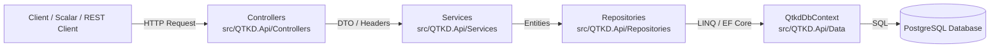

# HỆ THỐNG QUẢN TRỊ KINH DOANH (QTKD) — TUẦN 05, 06 & 07

- **Môn học:** Phát triển ứng dụng Hệ thống Thông tin Hiện đại
- **Công nghệ sử dụng:** .NET 10 (ASP.NET Core Web API), Entity Framework Core 10, PostgreSQL (Npgsql), Scalar API Reference.

---

## 1. Cấu trúc Repository & Kiến trúc hệ thống

Repository được tổ chức xuyên suốt 3 tuần thực hành theo đúng cấu trúc chuẩn: `src/` (mã nguồn), `tests/` (kiểm thử), `docs/` (tài liệu thiết kế/API/minh chứng) và `README.md`:

```text
QTKD/
├── QTKD.slnx                              # Solution file (.NET 10 format)
├── README.md                              # Hướng dẫn cài đặt, chạy dự án & tổng quan API
├── src/                                   # [Mã nguồn ứng dụng]
│   └── QTKD.Api/                          # Project ASP.NET Core Web API (Kiến trúc 3 tầng)
│       ├── Controllers/                   # Tầng API: Customers, Contracts, PriceLists
│       ├── Services/                      # Tầng Nghiệp vụ: Kiểm tra CTR-01..03 & US03
│       ├── Repositories/                  # Tầng Truy cập dữ liệu (EF Core)
│       ├── Data/                          # QtkdDbContext & Seed Data
│       ├── Models/                        # Domain Entities: Customer, Contract, PriceList, PriceItem
│       ├── DTOs/                          # Request & Response DTOs
│       ├── Migrations/                    # EF Core Migrations (Tuần 05 & Tuần 06)
│       ├── appsettings.Development.json   # Cấu hình chuỗi kết nối PostgreSQL
│       ├── Program.cs                     # Cấu hình DI & Middleware
│       └── QTKD.Api.http                  # Kịch bản kiểm thử trực tiếp toàn bộ API
├── tests/                                 # [Kiểm thử tự động - xUnit (Tuần 07)]
│   ├── QTKD.Tests.csproj                  # Project xUnit Test (.NET 10)
│   ├── UnitTests/                         # Kiểm thử đơn vị (Service & Business Rules CTR-01..03)
│   └── IntegrationTests/                  # Kiểm thử tích hợp (API & InMemory Database)
└── docs/                                  # [Tài liệu Thiết kế, Đặc tả API & Minh chứng]
    ├── API_AND_BUSINESS_RULES.md          # Danh sách API, mẫu Request/Response & Bảng đối chiếu US03/CTR-01..03
    └── evidence/                          # Thư mục lưu ảnh/video minh chứng demo qua các tuần
```

### Sơ đồ luồng xử lý 3 tầng:



---

## 2. Hướng dẫn Cài đặt, Chạy Migration & Khởi động API

### 2.1. Cấu hình chuỗi kết nối (`src/QTKD.Api/appsettings.Development.json`)

```json
{
  "ConnectionStrings": {
    "DefaultConnection": "Host=localhost;Port=5432;Database=QTKD;Username=postgres;Password=admin"
  }
}
```

### 2.2. Cập nhật Database qua EF Core Migration

Từ thư mục gốc `QTKD`, chạy lệnh:

```bash
dotnet ef database update --project src/QTKD.Api
```

### 2.3. Khởi động Web API

```bash
dotnet run --project src/QTKD.Api
```

- Địa chỉ API: `http://localhost:5211`
- Giao diện tài liệu tương tác (**Scalar**): **`http://localhost:5211/scalar/v1`**

---

## 3. Tóm tắt API & Đối chiếu Quy tắc Nghiệp vụ Tuần 06

> 📄 **Tài liệu chi tiết:** Xem đầy đủ mẫu Request/Response JSON, giả định bản Demo và giải thích chi tiết tại [`docs/API_AND_BUSINESS_RULES.md`](docs/API_AND_BUSINESS_RULES.md).

### 3.1. Danh sách Endpoint chính

| Phân hệ             | Phương thức & Endpoint                                                                                                                                 | Chức năng & Kiểm tra nghiệp vụ                                                                                                                                          |
| :------------------ | :----------------------------------------------------------------------------------------------------------------------------------------------------- | :---------------------------------------------------------------------------------------------------------------------------------------------------------------------- |
| **Customer**        | `GET /api/customers`<br>`GET /api/customers/{id}`<br>`POST /api/customers`<br>`PUT /api/customers/{id}`                                                | Xem danh sách, xem chi tiết, tạo mới và cập nhật khách hàng.<br>Kiểm tra `Name` bắt buộc, `Status` hợp lệ (`Active` / `Inactive`).                                      |
| **Contract & US03** | `GET /api/contracts`<br>`GET /api/contracts/{id}`<br>`POST /api/contracts`<br>`PUT /api/contracts/{id}`<br>**`POST /api/contracts/{id}/submit`**       | Quản lý hợp đồng và **Gửi hợp đồng trình duyệt (US03)**.<br>Kiểm tra ngày hiệu lực, trạng thái và các quy tắc **CTR-01, CTR-02, CTR-03**, **AC01..AC05**.               |
| **Pricing**         | `GET /api/pricelists`<br>`GET /api/pricelists/{id}`<br>`POST /api/pricelists`<br>`GET /api/pricelists/{id}/items`<br>`POST /api/pricelists/{id}/items` | Tạo/xem bảng giá (`PriceList`) và thêm/xem đơn giá dịch vụ (`PriceItem`).<br>Kiểm tra liên kết `PriceListId` tồn tại, `ServiceCode` không trùng và **`UnitPrice > 0`**. |

### 3.2. Bảng đối chiếu nhanh US03 & Quy tắc CTR-01..03

|         Mã          | Ý nghĩa                                                                                                                                       | Đoạn xử lý trong mã nguồn                                                                               | Cách kiểm tra & Kết quả                                                                                                  |
| :-----------------: | :-------------------------------------------------------------------------------------------------------------------------------------------- | :------------------------------------------------------------------------------------------------------ | :----------------------------------------------------------------------------------------------------------------------- |
|     **CTR-01**      | Chỉ cho sửa hợp đồng ở `Draft` hoặc `RevisionRequested`                                                                                       | [`ContractService.UpdateAsync`](src/QTKD.Api/Services/ContractService.cs)                               | Sửa hợp đồng đang ở `PendingApproval` $\rightarrow$ Bị từ chối `409 Conflict` (`CTR01_EDIT_NOT_ALLOWED`).                |
|     **CTR-02**      | Chỉ gửi khi `Customer` (`Active`), ngày hiệu lực (`StartDate <= EndDate`), nội dung (`ServiceGroup`) và tệp bắt buộc (`AttachmentUrl`) hợp lệ | [`ContractService.SubmitAsync`](src/QTKD.Api/Services/ContractService.cs)                               | Thiếu 1 điều kiện $\rightarrow$ Trả `400 Bad Request` (`CTR02_VALIDATION_FAILED`) kèm danh sách lỗi, giữ nguyên `Draft`. |
|     **CTR-03**      | Không được chuyển `Draft` thẳng sang `Approved`                                                                                               | [`ContractService.CreateAsync`](src/QTKD.Api/Services/ContractService.cs), `UpdateAsync`, `SubmitAsync` | Chặn truyền `Status = "Approved"` (`400`); `Submit` thành công chỉ chuyển sang `PendingApproval`.                        |
| **US03 (AC01..05)** | Kiểm tra quyền (`403`), trạng thái (`409`), điều kiện `CTR-02` (`400`), sinh `approvalId` (`200`) và chống gửi lặp 2 lần (`Idempotency-Key`)  | [`ContractService.SubmitAsync`](src/QTKD.Api/Services/ContractService.cs)                               | Gửi lần 2 cùng `Idempotency-Key` trả lại đúng `approvalId` cũ (`200 OK`); gửi lần 2 không khóa trả `409 Conflict`.       |

---

## 4. Hướng dẫn chạy Kịch bản Demo Tuần 06

Mở file [`src/QTKD.Api/QTKD.Api.http`](src/QTKD.Api/QTKD.Api.http) (hoặc giao diện Scalar tại `http://localhost:5211/scalar/v1`) và thực hiện theo thứ tự:

1. **Tạo Customer** (`POST /api/customers`).
2. **Tạo Contract Draft thiếu dữ liệu** (`POST /api/contracts` với `serviceGroup: null`, `attachmentUrl: null`).
3. **Gửi trình duyệt khi thiếu dữ liệu** (`POST /api/contracts/{id}/submit`) $\rightarrow$ Thất bại `400 Bad Request` (vi phạm `CTR-02`).
4. **Bổ sung dữ liệu còn thiếu** (`PUT /api/contracts/{id}` với đầy đủ `serviceGroup` và `attachmentUrl`).
5. **Gửi trình duyệt lại** (`POST /api/contracts/{id}/submit`) $\rightarrow$ Thành công `200 OK`, chuyển sang `PendingApproval` kèm mã `approvalId`.
6. **Thử gửi lần 2 & Thử sửa khi `PendingApproval`** $\rightarrow$ Kiểm chứng chống gửi lặp (`AC05`) và chặn sửa (`CTR-01`).
7. **Kiểm tra trạng thái trong PostgreSQL:**
   ```sql
   SELECT "Id", "ContractNo", "CustomerId", "Status", "ServiceGroup", "AttachmentUrl", "ApprovalId", "SubmittedAt"
   FROM "Contracts";
   ```

---

## 5. Hướng dẫn Chạy Kiểm thử Tự động (Tuần 07)

Dự án kiểm thử tự động được đặt tại `tests/`, tách biệt rõ ràng 2 tầng kiểm thử:
- **Unit Tests:** Kiểm tra logic nghiệp vụ tại tầng Service (`CustomerServiceTests`, `ContractServiceTests`, `PriceListServiceTests`) sử dụng thư viện `Moq` để mock các Repository.
- **Integration Tests:** Kiểm tra tích hợp end-to-end từ HTTP Endpoint đến Database (`CustomerApiTests`, `ContractApiTests`) sử dụng `CustomWebApplicationFactory` và Database InMemory độc lập theo đúng quy định mục 16.

### 5.1. Lệnh thực thi kiểm thử và xuất kết quả
Từ thư mục gốc `QTKD`, chạy lệnh:
```bash
dotnet test --logger "trx;LogFileName=test_results.trx"
```
Kết quả kiểm thử được lưu tự động tại:
- `tests/TestResults/test_results.trx`
- `docs/evidence/test_results.trx`

### 5.2. Bảng kết quả kiểm thử tối thiểu (TC01 - TC08 theo Mục 5.3)

| Mã Test | Dữ liệu / Thao tác kiểm thử | Kết quả mong đợi | Hình thức | Kết quả | Class kiểm thử tương ứng |
| :---: | :--- | :--- | :---: | :---: | :--- |
| **TC01** | Tạo Customer hợp lệ | Tạo thành công (201 Created), đọc lại được từ DB | Tự động | **PASS** | `CustomerApiTests.TC01_CreateCustomer_WithValidData_ReturnsCreated_AndPersistsToDatabase` |
| **TC02** | Tạo Customer thiếu thông tin bắt buộc (`Name` rỗng) | Bị từ chối (400 Bad Request), có thông báo lỗi | Tự động | **PASS** | `CustomerApiTests.TC02_CreateCustomer_MissingName_ReturnsBadRequest_WithErrorDetail`<br>`CustomerServiceTests.TC02_CreateCustomer_MissingRequiredName_ReturnsBadRequest` |
| **TC03** | Sửa Contract khi đang ở trạng thái `Draft` | Thành công (200 OK) khi dữ liệu hợp lệ | Tự động | **PASS** | `ContractApiTests.TC03_UpdateContract_WhenInDraftStatus_ReturnsOk_AndUpdatesDatabase`<br>`ContractServiceTests.TC03_UpdateContract_WhenStatusIsDraft_ReturnsSuccess` |
| **TC04** | Sửa Contract khi đang ở trạng thái `PendingApproval` | Bị từ chối (409 Conflict - `CTR01_EDIT_NOT_ALLOWED`), dữ liệu giữ nguyên | Tự động | **PASS** | `ContractApiTests.TC04_UpdateContract_WhenInPendingApprovalStatus_ReturnsConflict_AndDataUnchanged`<br>`ContractServiceTests.TC04_UpdateContract_WhenStatusNotEditable_ReturnsConflict` |
| **TC05** | Submit Contract thiếu điều kiện CTR-02 (thiếu tệp hoặc nội dung) | Bị từ chối (400 Bad Request - `CTR02_VALIDATION_FAILED`), vẫn giữ nguyên trạng thái `Draft` | Tự động | **PASS** | `ContractApiTests.TC05_SubmitContract_WhenMissingCTR02Conditions_ReturnsBadRequest_AndRemainsDraft`<br>`ContractServiceTests.TC05_SubmitContract_MissingRequiredContentAndAttachment_ReturnsBadRequest` |
| **TC06** | Submit Contract hợp lệ (Customer Active, đủ tệp và nội dung) | Thành công (200 OK), chuyển sang `PendingApproval`, sinh mã `ApprovalId` | Tự động | **PASS** | `ContractApiTests.TC06_SubmitContract_WhenValid_TransitionsToPendingApproval_AndPersistsToDb`<br>`ContractServiceTests.TC06_SubmitContract_WhenAllConditionsMet_TransitionsToPendingApproval` |
| **TC07** | Thử chuyển Contract từ `Draft` thẳng sang `Approved` qua POST/PUT | Bị từ chối (400 Bad Request - `CTR03_DIRECT_STATUS_FORBIDDEN` / `CTR03_DIRECT_APPROVAL_FORBIDDEN`) | Tự động | **PASS** | `ContractApiTests.TC07_CreateContract_DirectApprovedStatus_ReturnsBadRequest`<br>`ContractServiceTests.TC07_CreateContract_DirectApprovedStatus_ReturnsBadRequest` |
| **TC08** | Submit lặp một Contract (gửi lần 2 với cùng hoặc khác khóa) | Cùng `Idempotency-Key` trả về cùng `ApprovalId` cũ (không trùng lặp); khác/không khóa trả 409 Conflict | Tự động | **PASS** | `ContractApiTests.TC08_SubmitContract_DoubleSubmit_ReturnsSameApprovalIdWithoutDuplicate`<br>`ContractServiceTests.TC08_SubmitContract_DoubleSubmitWithSameKey_ReturnsSameApprovalIdWithoutDuplicate` |

### 5.3. Ghi nhận lỗi phát hiện trong quá trình kiểm thử & Cách xử lý (Mục 5.4)
1. **Lỗi xung đột Database Provider trong Integration Tests:**
   - *Cách tái hiện:* Khi chạy `WebApplicationFactory<Program>`, `Program.cs` mặc định đăng ký `UseNpgsql`, đồng thời `CustomWebApplicationFactory` đăng ký thêm `UseInMemoryDatabase`.
   - *Nguyên nhân:* EF Core cấm đăng ký đồng thời 2 provider trong cùng một Service Provider (`InvalidOperationException: Only a single database provider can be registered`).
   - *Giải pháp:* Tại `src/QTKD.Api/Program.cs`, thêm điều kiện `if (!builder.Environment.IsEnvironment("Testing"))` trước khi đăng ký PostgreSQL. Khi chạy test với môi trường `"Testing"`, hệ thống tự động sử dụng In-Memory Database riêng biệt, đảm bảo tính cô lập và hiệu năng cao.
2. **Lỗi đồng bộ phiên bản EF Core Relational:**
   - *Cách tái hiện:* Khi biên dịch `QTKD.Tests.csproj` với `net10.0`, package `Microsoft.EntityFrameworkCore.Relational` xảy ra warning xung đột giữa bản `10.0.4` và `10.0.14`.
   - *Giải pháp:* Khai báo rõ ràng `<PackageReference Include="Microsoft.EntityFrameworkCore.Relational" Version="10.0.14" />` trong file `tests/QTKD.Tests.csproj` để đồng bộ hoàn toàn với bản Design của API project.

