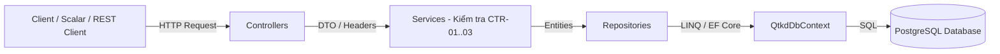

# HỆ THỐNG QUẢN TRỊ KINH DOANH (QTKD) — TUẦN 05 & TUẦN 06

- **Môn học:** Phát triển ứng dụng Hệ thống Thông tin Hiện đại
- **Công nghệ sử dụng:** .NET 10 (ASP.NET Core Web API), Entity Framework Core 10, PostgreSQL (Npgsql), Scalar API Reference.

---

## 1. Cấu trúc Solution & Kiến trúc hệ thống

Dự án được tổ chức theo **Kiến trúc 3 lớp (3-tier Architecture)**, phân tách rõ ràng giữa tầng API (`Controllers`), Xử lý nghiệp vụ (`Services`) và Truy cập dữ liệu (`Repositories`):

```text
QTKD/
├── QTKD.slnx                              # Solution file (.NET 10 format)
└── QTKD.Api/                              # Project Web API
    ├── Controllers/                       # [Tầng API / Presentation]
    │   ├── CustomersController.cs         # API Quản lý khách hàng
    │   ├── ContractsController.cs         # API Quản lý hợp đồng & US03 Submit
    │   └── PriceListsController.cs        # API Quản lý bảng giá & đơn giá
    ├── Services/                          # [Tầng Nghiệp vụ / Business Logic]
    │   ├── ICustomerService.cs & CustomerService.cs
    │   ├── IContractService.cs & ContractService.cs   # Kiểm tra CTR-01, CTR-02, CTR-03 & US03
    │   └── IPriceListService.cs & PriceListService.cs
    ├── Repositories/                      # [Tầng Truy cập dữ liệu / Data Access]
    │   ├── ICustomerRepository.cs & CustomerRepository.cs
    │   ├── IContractRepository.cs & ContractRepository.cs
    │   └── IPriceListRepository.cs & PriceListRepository.cs
    ├── Data/                              # [Cơ sở dữ liệu EF Core]
    │   └── QtkdDbContext.cs               # DbContext, cấu hình quan hệ & dữ liệu mẫu
    ├── Models/                            # [Domain Entities]
    │   ├── Customer.cs                    # Khách hàng
    │   ├── Contract.cs                    # Hợp đồng (hỗ trợ US03 & CTR-02)
    │   ├── PriceList.cs                   # Bảng giá
    │   └── PriceItem.cs                   # Đơn giá dịch vụ
    ├── DTOs/                              # [Data Transfer Objects]
    │   ├── Requests/                      # CustomerRequests, ContractRequests, PriceListRequests
    │   └── Responses/                     # CustomerResponse, ContractResponse, SubmitContractResponse, PriceListResponse, ServiceResult
    ├── Migrations/                        # EF Core Migrations (InitialCreate & Week06_UpdateContractForUS03)
    ├── appsettings.Development.json       # Cấu hình chuỗi kết nối DB
    ├── Program.cs                         # Cấu hình DI container & Middleware pipeline
    └── QTKD.Api.http                      # File kịch bản kiểm thử toàn bộ luồng Tuần 05 & 06
```

### Sơ đồ luồng xử lý:



---

## 2. Hướng dẫn Cài đặt, Chạy Migration & Khởi động API

### 2.1. Cấu hình chuỗi kết nối (`QTKD.Api/appsettings.Development.json`)
```json
{
  "ConnectionStrings": {
    "DefaultConnection": "Host=localhost;Port=5432;Database=QTKD;Username=postgres;Password=admin"
  }
}
```

### 2.2. Cập nhật Database qua EF Core Migration
Từ thư mục `QTKD`, chạy lệnh:
```bash
dotnet ef database update --project QTKD.Api
```

### 2.3. Khởi động Web API
```bash
dotnet run --project QTKD.Api
```
- Địa chỉ API: `http://localhost:5211`
- Giao diện tài liệu tương tác (**Scalar**): **`http://localhost:5211/scalar/v1`**

---

## 3. Đặc tả chi tiết US03 – Gửi hợp đồng trình duyệt (Mục 4.3 & 4.4)

### 3.1. Điều kiện gửi hợp đồng, trạng thái trước/sau và trường hợp từ chối
- **Trạng thái trước khi gửi:** Hợp đồng bắt buộc phải đang ở trạng thái `Draft` (Bản nháp).
- **Trạng thái sau khi gửi thành công:** Chuyển sang `PendingApproval` (Chờ phê duyệt) — tuân thủ **CTR-03** (không cho phép chuyển thẳng từ `Draft` sang `Approved`).
- **Điều kiện gửi hợp lệ (Quy tắc `CTR-02`):**
  1. **Khách hàng hợp lệ:** `Customer` được tham chiếu tồn tại và có `Status == "Active"`.
  2. **Ngày hiệu lực hợp lệ:** `StartDate <= EndDate`.
  3. **Nội dung bắt buộc hợp lệ:** Trường `ServiceGroup` (Nhóm dịch vụ) đã được khai báo, không để trống.
  4. **Tệp đính kèm bắt buộc hợp lệ:** Trường `AttachmentUrl` (Đường dẫn tệp hợp đồng đính kèm) đã được khai báo, không để trống.
- **Các trường hợp bị từ chối:**
  - Người dùng không thuộc vai trò Nhân viên Kinh doanh (`X-User-Role` khác `Sales` / `KinhDoanh`) $\rightarrow$ Từ chối với mã `403 Forbidden` (**AC01**).
  - Hợp đồng không ở trạng thái `Draft` (đang ở `PendingApproval`, `Approved`, `Rejected`, `RevisionRequested`) $\rightarrow$ Từ chối với mã `409 Conflict` (**AC02**).
  - Thiếu bất kỳ điều kiện nào của **CTR-02** $\rightarrow$ Từ chối với mã `400 Bad Request` kèm danh sách cụ thể các điều kiện chưa đạt; hợp đồng giữ nguyên trạng thái `Draft` (**AC03**).

### 3.2. Giả định trong bản Demo & Giới hạn phiên bản hiện tại (Lưu ý Mục 4.3 Bước 12 & Mục 4.4)
1. **Giả định về nội dung/tệp bắt buộc (`CTR-02`):**
   - Trong đặc tả Phase 1 (`USER_STORY03.md` Mục 4 – Q2 & Mục 10), danh sách chi tiết các trường nội dung và tệp bắt buộc cho từng loại hợp đồng đang ở mục *"Cần xác nhận"*.
   - Để phục vụ bản demo Tuần 06, hệ thống sử dụng 2 trường đại diện trên bảng `Contracts` là **`ServiceGroup`** (đại diện cho *Nội dung bắt buộc*) và **`AttachmentUrl`** (đại diện cho *Tệp đính kèm bắt buộc*). Khi lưu nháp (`POST /api/contracts`), hai trường này được phép để `null`; khi gọi `POST /api/contracts/{id}/submit`, cả hai trường bắt buộc phải có dữ liệu.
2. **Cách mô phỏng việc gửi trình duyệt & Chống gửi lặp (`AC04`, `AC05`):**
   - Vì phạm vi Tuần 06 chưa xây dựng phân hệ `Approval` đầy đủ, khi gửi hợp đồng hợp lệ, `ContractService.SubmitAsync` mô phỏng việc khởi tạo quy trình phê duyệt bằng cách sinh mã phiên phê duyệt `ApprovalId` theo định dạng `APR-{yyyyMMdd}-{ContractId:D4}` (ví dụ: `APR-20261105-0001`), lưu thời điểm `SubmittedAt`, ghi chú `SubmitComment` và `IdempotencyKey` ngay trên bản ghi `Contract`.
   - **Xử lý gửi 2 lần liên tiếp (Bước 12):**
     - **Trường hợp 1 (Có gửi kèm cùng header `Idempotency-Key`):** Lần gọi thứ 2 nhận diện trùng `IdempotencyKey` trên hợp đồng đang `PendingApproval` nên trả về ngay kết quả `200 OK` với cùng `approvalId` đã sinh ở lần 1 (không tạo thêm phiên xử lý mới).
     - **Trường hợp 2 (Gửi lần 2 không có hoặc khác `Idempotency-Key`):** Do hợp đồng đã chuyển sang `PendingApproval` ở lần 1, lần gọi thứ 2 bị chặn bởi kiểm tra trạng thái và trả về `409 Conflict` (`AC02_INVALID_CONTRACT_STATE`).
   - **Giới hạn hiện tại:** Chưa tách bảng `ApprovalInstances` / `ApprovalSteps` riêng và chưa thực hiện các bước duyệt kế tiếp (Pháp chế rà soát, Ban Giám đốc phê duyệt).

---

## 4. Bảng đối chiếu Quy tắc Nghiệp vụ & Tiêu chí Chấp nhận với Mã nguồn (Mục 4.5)

| Mã quy tắc / AC | Ý nghĩa nghiệp vụ | Vị trí xử lý trong mã nguồn | Mã HTTP & Hành vi kiểm tra |
| :---: | :--- | :--- | :--- |
| **CTR-01** | Chỉ cho sửa hợp đồng ở `Draft` hoặc `RevisionRequested` | `ContractService.UpdateAsync` (`QTKD.Api/Services/ContractService.cs`) | Trả `409 Conflict` (`CTR01_EDIT_NOT_ALLOWED`) khi gọi `PUT /api/contracts/{id}` lúc hợp đồng đang ở `PendingApproval`, `Approved`, `Rejected`. |
| **CTR-02** | Chỉ gửi khi `Customer` (`Active`), ngày hiệu lực (`StartDate <= EndDate`), nội dung (`ServiceGroup`) và tệp bắt buộc (`AttachmentUrl`) hợp lệ | `ContractService.SubmitAsync` (`QTKD.Api/Services/ContractService.cs`) | Trả `400 Bad Request` (`CTR02_VALIDATION_FAILED`) kèm mảng `errors` liệt kê đầy đủ các điều kiện thiếu; dữ liệu hợp đồng không đổi. |
| **CTR-03** | Không được chuyển `Draft` thẳng sang `Approved` | `ContractService.CreateAsync`, `UpdateAsync`, `SubmitAsync` (`QTKD.Api/Services/ContractService.cs`) | Chặn truyền `Status = "Approved"` ở `POST`/`PUT` (`400 Bad Request`); khi `Submit` thành công chỉ chuyển từ `Draft` sang `PendingApproval`. |
| **AC01 (TC01)** | Người dùng không có quyền gửi $\rightarrow$ từ chối | `ContractService.SubmitAsync` (kiểm tra header `X-User-Role`) | Trả `403 Forbidden` (`AC01_FORBIDDEN`) nếu `X-User-Role` khác `Sales` / `KinhDoanh`. |
| **AC02 (TC02)** | Hợp đồng không ở trạng thái cho phép gửi $\rightarrow$ từ chối | `ContractService.SubmitAsync` (kiểm tra `Status == "Draft"`) | Trả `409 Conflict` (`AC02_INVALID_CONTRACT_STATE`) nếu trạng thái khác `Draft`. |
| **AC03 (TC03)** | Không đáp ứng `CTR-02` $\rightarrow$ trả danh sách điều kiện chưa đạt | `ContractService.SubmitAsync` | Trả `400 Bad Request` kèm danh sách `errors` chi tiết, giữ nguyên `Draft`. |
| **AC04 (TC04)** | Đáp ứng đủ điều kiện $\rightarrow$ tạo phiên phê duyệt & chuyển `PendingApproval` | `ContractService.SubmitAsync` | Trả `200 OK` kèm `contractId`, `status: "PendingApproval"`, `approvalId`. |
| **AC05 (TC05)** | Gửi lặp 2 lần không tạo nhiều phiên phê duyệt | `ContractService.SubmitAsync` (kiểm tra `Idempotency-Key` & trạng thái `PendingApproval`) | Cùng `Idempotency-Key` trả lại đúng `approvalId` cũ (`200 OK`); khác khóa trả `409 Conflict`. |

---

## 5. Danh sách API & Mẫu Request / Response (Tuần 06)

### 5.1. Nhóm API Khách hàng (`Customer`)

| Phương thức | Endpoint | Mô tả |
| :---: | :--- | :--- |
| `GET` | `/api/customers` | Lấy danh sách khách hàng |
| `GET` | `/api/customers/{id}` | Xem chi tiết khách hàng theo ID |
| `POST` | `/api/customers` | Tạo mới khách hàng (Kiểm tra `Name` bắt buộc, `Status` hợp lệ) |
| `PUT` | `/api/customers/{id}` | Cập nhật thông tin & trạng thái khách hàng |

- **Request mẫu (`POST /api/customers`):**
  ```json
  {
    "name": "Công ty Cổ phần Logistics Minh Phát Chi nhánh Nam",
    "status": "Active"
  }
  ```
- **Response thành công (`201 Created`):**
  ```json
  {
    "id": 3,
    "name": "Công ty Cổ phần Logistics Minh Phát Chi nhánh Nam",
    "status": "Active"
  }
  ```

---

### 5.2. Nhóm API Hợp đồng (`Contract`) & US03 Submit

| Phương thức | Endpoint | Mô tả |
| :---: | :--- | :--- |
| `GET` | `/api/contracts` | Lấy danh sách tất cả hợp đồng |
| `GET` | `/api/contracts/{id}` | Xem chi tiết hợp đồng theo ID |
| `POST` | `/api/contracts` | Tạo hợp đồng nháp (`Draft`) |
| `PUT` | `/api/contracts/{id}` | Cập nhật hợp đồng (Kiểm tra **CTR-01** & **CTR-03**) |
| `POST` | `/api/contracts/{id}/submit` | **US03:** Gửi hợp đồng trình duyệt (Kiểm tra **AC01..05**, **CTR-02**, **CTR-03**) |

#### A. Tạo hợp đồng nháp (`POST /api/contracts`)
- **Request:**
  ```json
  {
    "contractNo": "HD-2026-019",
    "customerId": 1,
    "startDate": "2026-11-01",
    "endDate": "2027-10-31",
    "serviceGroup": null,
    "attachmentUrl": null
  }
  ```
- **Response (`201 Created`):**
  ```json
  {
    "id": 2,
    "contractNo": "HD-2026-019",
    "customerId": 1,
    "customerName": "Công ty TNHH MTV Minh Phát",
    "startDate": "2026-11-01",
    "endDate": "2027-10-31",
    "status": "Draft",
    "serviceGroup": null,
    "attachmentUrl": null,
    "approvalId": null,
    "submittedAt": null,
    "submitComment": null,
    "createdAt": "2026-11-05T13:45:00Z"
  }
  ```

#### B. Gửi trình duyệt khi thiếu dữ liệu bắt buộc (`POST /api/contracts/2/submit`) — Thất bại `400 Bad Request` (Vi phạm CTR-02)
- **Request:**
  ```json
  {
    "comment": "Gửi trình duyệt khi chưa bổ sung đủ thông tin"
  }
  ```
- **Response (`400 Bad Request`):**
  ```json
  {
    "code": "CTR02_VALIDATION_FAILED",
    "message": "Hợp đồng chưa đủ điều kiện gửi trình duyệt theo quy tắc CTR-02. Vui lòng hoàn tất các nội dung còn thiếu.",
    "errors": [
      "Thiếu nội dung bắt buộc: Nhóm dịch vụ (ServiceGroup) chưa được khai báo.",
      "Thiếu tệp bắt buộc: Tệp đính kèm hợp đồng (AttachmentUrl) chưa được bổ sung."
    ]
  }
  ```

#### C. Cập nhật bổ sung dữ liệu cho hợp đồng nháp (`PUT /api/contracts/2`) — Thành công `200 OK`
- **Request:**
  ```json
  {
    "customerId": 1,
    "startDate": "2026-11-01",
    "endDate": "2027-10-31",
    "serviceGroup": "Dịch vụ cảng",
    "attachmentUrl": "files/HD-2026-019-minh-phat.pdf"
  }
  ```

#### D. Gửi trình duyệt lại sau khi đã đủ điều kiện (`POST /api/contracts/2/submit`) — Thành công `200 OK`
- **Headers:**
  - `X-User-Role: Sales`
  - `Idempotency-Key: submit-hd-2026-019-key-01`
- **Request:**
  ```json
  {
    "comment": "Đã bổ sung đầy đủ nhóm dịch vụ và tệp hợp đồng đính kèm."
  }
  ```
- **Response (`200 OK`):**
  ```json
  {
    "contractId": 2,
    "contractNo": "HD-2026-019",
    "status": "PendingApproval",
    "approvalId": "APR-20261105-0002",
    "submittedAt": "2026-11-05T13:46:10Z",
    "message": "Hợp đồng đã được gửi vào quy trình phê duyệt."
  }
  ```

#### E. Thử sửa hợp đồng khi đang ở `PendingApproval` (`PUT /api/contracts/2`) — Thất bại `409 Conflict` (Vi phạm CTR-01)
- **Response (`409 Conflict`):**
  ```json
  {
    "code": "CTR01_EDIT_NOT_ALLOWED",
    "message": "Quy tắc CTR-01: Không được phép chỉnh sửa hợp đồng đang ở trạng thái 'PendingApproval'. Chỉ cho phép sửa khi ở trạng thái 'Draft' hoặc 'RevisionRequested'."
  }
  ```

---

### 5.3. Nhóm API Bảng giá & Đơn giá (`Pricing`)

| Phương thức | Endpoint | Mô tả |
| :---: | :--- | :--- |
| `GET` | `/api/pricelists` | Xem danh sách bảng giá (kèm `Items`) |
| `GET` | `/api/pricelists/{id}` | Xem chi tiết bảng giá theo ID |
| `POST` | `/api/pricelists` | Tạo bảng giá mới |
| `GET` | `/api/pricelists/{id}/items` | Xem danh sách `PriceItem` của một bảng giá |
| `POST` | `/api/pricelists/{id}/items` | Thêm `PriceItem` vào bảng giá (Kiểm tra `PriceList` tồn tại & `UnitPrice > 0`) |

- **Request mẫu thêm đơn giá (`POST /api/pricelists/1/items`):**
  ```json
  {
    "serviceCode": "PORT_CRANE_LIFT",
    "unitPrice": 450000
  }
  ```
- **Response (`201 Created`):**
  ```json
  {
    "id": 3,
    "priceListId": 1,
    "serviceCode": "PORT_CRANE_LIFT",
    "unitPrice": 450000
  }
  ```

---

## 6. Hướng dẫn chạy Kịch bản Demo Tuần 06 (Bước 13 Mục 4.3)

Mở file [`QTKD.Api/QTKD.Api.http`](QTKD.Api/QTKD.Api.http) trong VS Code / Visual Studio (hoặc dùng giao diện Scalar tại `http://localhost:5211/scalar/v1`) và chạy lần lượt các bước đã đánh số sẵn:
1. **Tạo Customer** (`POST /api/customers`).
2. **Tạo Contract Draft thiếu dữ liệu** (`POST /api/contracts` với `serviceGroup: null`, `attachmentUrl: null`).
3. **Gửi trình duyệt khi thiếu dữ liệu** (`POST /api/contracts/{id}/submit`) $\rightarrow$ Nhận lỗi `400 Bad Request` (`CTR02_VALIDATION_FAILED`), trạng thái vẫn là `Draft`.
4. **Bổ sung dữ liệu còn thiếu** (`PUT /api/contracts/{id}` với đầy đủ `serviceGroup` và `attachmentUrl`).
5. **Gửi trình duyệt lại** (`POST /api/contracts/{id}/submit`) $\rightarrow$ Thành công `200 OK`, trạng thái đổi sang `PendingApproval` và nhận `approvalId`.
6. **Gửi lặp lần 2** (`POST /api/contracts/{id}/submit`) và **Thử sửa hợp đồng khi đang `PendingApproval`** (`PUT /api/contracts/{id}`) $\rightarrow$ Kiểm chứng `AC05` và `CTR-01`.
7. **Kiểm tra trạng thái trong PostgreSQL:**
   ```sql
   SELECT "Id", "ContractNo", "CustomerId", "Status", "ServiceGroup", "AttachmentUrl", "ApprovalId", "SubmittedAt"
   FROM "Contracts";
   ```
