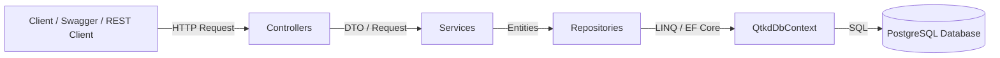

# HỆ THỐNG QUẢN TRỊ KINH DOANH (QTKD)

- **Môn học:** Phát triển ứng dụng Hệ thống Thông tin Hiện đại
- **Công nghệ sử dụng:** .NET 10 (ASP.NET Core Web API), Entity Framework Core 10, PostgreSQL (Npgsql), Scalar API Reference.

---

## 1. Cấu trúc Solution & Kiến trúc hệ thống

Dự án được tổ chức theo **Kiến trúc 3 lớp (3-tier Architecture)**, phân tách rạch ròi giữa API, Xử lý nghiệp vụ và Truy cập dữ liệu

```text
QTKD/
├── QTKD.slnx                          # Solution file (.NET 10 format)
└── QTKD.Api/                          # Project Web API
    ├── Controllers/                   # [Tầng API / Presentation]
    │   ├── CustomersController.cs     # Endpoint GET /api/customers
    │   └── ContractsController.cs     # Endpoint GET /api/contracts/{id}
    ├── Services/                      # [Tầng Nghiệp vụ / Business Logic]
    │   ├── ICustomerService.cs & CustomerService.cs
    │   └── IContractService.cs & ContractService.cs
    ├── Repositories/                  # [Tầng Truy cập dữ liệu / Data Access]
    │   ├── ICustomerRepository.cs & CustomerRepository.cs
    │   └── IContractRepository.cs & ContractRepository.cs
    ├── Data/                          # [Cơ sở dữ liệu EF Core]
    │   └── QtkdDbContext.cs           # DbContext, cấu hình quan hệ & dữ liệu mẫu
    ├── Models/                        # [Domain Entities]
    │   ├── Customer.cs                # Khách hàng
    │   ├── Contract.cs                # Hợp đồng
    │   ├── PriceList.cs               # Bảng giá
    │   └── PriceItem.cs               # Đơn giá dịch vụ
    ├── DTOs/                          # [Data Transfer Objects]
    │   └── Responses/
    │       ├── CustomerResponse.cs
    │       └── ContractResponse.cs
    ├── Migrations/                    # EF Core Migrations
    ├── appsettings.Development.json   # Cấu hình chuỗi kết nối DB
    ├── Program.cs                     # Cấu hình DI container & Middleware pipeline
    └── QTKD.Api.http                  # File kịch bản kiểm thử API trực tiếp
```

### Sơ đồ luồng xử lý:



---

## 2. Hướng dẫn Cài đặt & Cấu hình Database

### Yêu cầu môi trường:

- `.NET 10 SDK` (hoặc .NET 9 trở lên)
- `PostgreSQL` (phiên bản 14 trở lên, dịch vụ đang chạy trên cổng mặc định `5432`)
- Công cụ EF Core CLI (`dotnet-ef`): Nếu chưa có, chạy lệnh:
  ```bash
  dotnet tool install --global dotnet-ef
  ```

### Cấu hình chuỗi kết nối (Connection String):

Mở file `QTKD.Api/appsettings.Development.json` và điều chỉnh thông tin kết nối tới PostgreSQL của bạn:

```json
{
  "Logging": {
    "LogLevel": {
      "Default": "Information",
      "Microsoft.AspNetCore": "Warning"
    }
  },
  "ConnectionStrings": {
    "DefaultConnection": "Host=localhost;Port=5432;Database=QTKD;Username=postgres;Password=admin"
  }
}
```

---

## 3. Chạy Migration & Cập nhật Cơ sở dữ liệu

Từ thư mục `QTKD`:

### Bước 1: Tạo Migration

```bash
dotnet ef migrations add InitialCreate --project QTKD.Api
```

### Bước 2: Cập nhật Database

Chạy lệnh sau để EF Core tự động kết nối vào PostgreSQL, tạo 4 bảng và nạp sẵn dữ liệu mẫu:

```bash
dotnet ef database update --project QTKD.Api
```

### Dữ liệu mẫu đã nạp sẵn:

- **2 Khách hàng (`Customers`):**
  - ID 1: _Công ty TNHH MTV Minh Phát_ (Status: `Active`)
  - ID 2: _Công ty Cổ phần Vận tải Biển Đông_ (Status: `Active`)
- **1 Hợp đồng (`Contracts`):**
  - ID 1: Số hiệu `HD-2026-018`, CustomerId = 1, Hiệu lực từ `01/10/2026` đến `30/09/2027`, Trạng thái: `Draft`, Nhóm dịch vụ: `Dịch vụ cảng`.
- **1 Bảng giá (`PriceLists`):**
  - ID 1: _Bảng giá Dịch vụ Cảng 2026_, Ngày hiệu lực: `01/01/2026`
- **2 Mục đơn giá (`PriceItems`):**
  - ID 1: Mã `PORT_STORAGE`, Đơn giá `150,000`
  - ID 2: Mã `PORT_HANDLING`, Đơn giá `350,000`

---

## 4. Khởi động Web API

Chạy lệnh sau từ thư mục `QTKD`:

```bash
dotnet run --project QTKD.Api
```

Sau khi khởi động thành công, ứng dụng sẽ lắng nghe tại:

- HTTP: `http://localhost:5211`
- Giao diện tài liệu API tương tác (**Scalar**):
  👉 **`http://localhost:5211/scalar/v1`**

---

## 5. Thử nghiệm 2 Endpoint API

Bạn có thể kiểm thử trực tiếp bằng:

- File kịch bản `QTKD.Api.http` trong mã nguồn.
- Giao diện Scalar tại `http://localhost:5211/scalar/v1`.

---

### Endpoint 1: Lấy danh sách khách hàng (`GET /api/customers`)

- **HTTP Request:**
  ```http
  GET http://localhost:5211/api/customers
  Accept: application/json
  ```
- **Kết quả mong đợi (`200 OK`):**
  ```json
  [
    {
      "id": 1,
      "name": "Công ty TNHH MTV Minh Phát",
      "status": "Active"
    },
    {
      "id": 2,
      "name": "Công ty Cổ phần Vận tải Biển Đông",
      "status": "Active"
    }
  ]
  ```

---

### Endpoint 2: Lấy chi tiết hợp đồng theo ID (`GET /api/contracts/{id}`)

#### Kịch bản 1: Hợp đồng hợp lệ (`200 OK`)

- **HTTP Request:**
  ```http
  GET http://localhost:5211/api/contracts/1
  Accept: application/json
  ```
- **Kết quả mong đợi (`200 OK`):**
  ```json
  {
    "id": 1,
    "contractNo": "HD-2026-018",
    "customerId": 1,
    "customerName": "Công ty TNHH MTV Minh Phát",
    "startDate": "2026-10-01",
    "endDate": "2027-09-30",
    "status": "Draft",
    "serviceGroup": "Dịch vụ cảng",
    "createdAt": "2026-10-01T00:00:00Z"
  }
  ```

#### Kịch bản 2: Hợp đồng không tồn tại (`404 Not Found`)

- **HTTP Request:**
  ```http
  GET http://localhost:5211/api/contracts/999
  Accept: application/json
  ```
- **Kết quả mong đợi (`404 Not Found`):**
  ```json
  {
    "message": "Không tìm thấy hợp đồng với ID = 999"
  }
  ```

---

## 6. Đối chiếu dữ liệu trong PostgreSQL

Mở pgAdmin hoặc chạy lệnh SQL trong `psql` để xác minh dữ liệu trả về từ API trùng khớp hoàn toàn với database:

```sql
-- 1. Kiểm tra bảng Khách hàng
SELECT "Id", "Name", "Status" FROM "Customers";

-- 2. Kiểm tra bảng Hợp đồng
SELECT "Id", "ContractNo", "CustomerId", "StartDate", "EndDate", "Status" FROM "Contracts";

-- 3. Kiểm tra bảng Bảng giá & Đơn giá dịch vụ
SELECT p."Name" AS "BangGia", i."ServiceCode", i."UnitPrice"
FROM "PriceLists" p
JOIN "PriceItems" i ON p."Id" = i."PriceListId";
```
