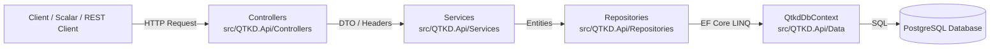
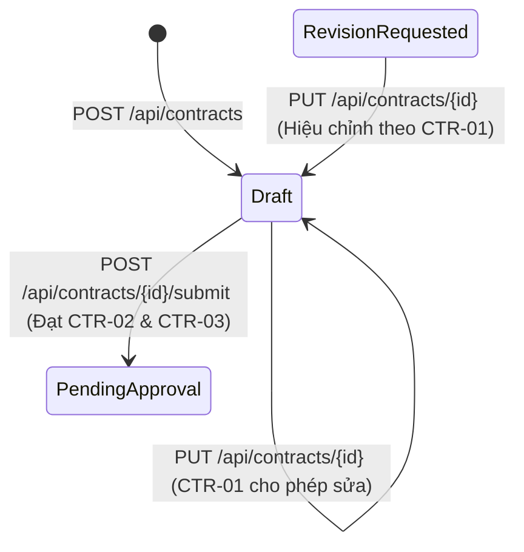

# TÀI LIỆU THIẾT KẾ, ĐẶC TẢ API & ĐỐI CHIẾU QUY TẮC NGHIỆP VỤ (TUẦN 05 & 06)

Tài liệu này tổng hợp kiến trúc thành phần, đặc tả chi tiết **US03 – Gửi hợp đồng trình duyệt**, danh sách API kèm mẫu Request/Response và bảng đối chiếu mã nguồn cho **Tuần 05 & Tuần 06**.

---

## 1. Sơ đồ Kiến trúc Thành phần & Trạng thái Hợp đồng

### 1.1. Kiến trúc 3 tầng (3-Tier Architecture)



### 1.2. Sơ đồ chuyển trạng thái Hợp đồng trong phạm vi US03



---

## 2. Đặc tả chi tiết US03 – Gửi hợp đồng trình duyệt

### 2.1. Điều kiện gửi, trạng thái trước/sau và trường hợp từ chối

- **Trạng thái trước khi gửi:** `Draft` (Bản nháp).
- **Trạng thái sau khi gửi thành công:** `PendingApproval` (Chờ phê duyệt) — tuân thủ **CTR-03** (không chuyển thẳng sang `Approved`).
- **4 điều kiện bắt buộc của quy tắc `CTR-02`:**
  1. **Khách hàng hợp lệ:** `Customer` tồn tại và có `Status == "Active"`.
  2. **Ngày hiệu lực hợp lệ:** `StartDate <= EndDate`.
  3. **Nội dung bắt buộc hợp lệ:** Trường `ServiceGroup` (Nhóm dịch vụ) đã được khai báo, không để trống.
  4. **Tệp đính kèm bắt buộc hợp lệ:** Trường `AttachmentUrl` (Tệp hợp đồng đính kèm) đã được khai báo, không để trống.
- **Trường hợp phải từ chối:**
  - Người dùng không có quyền Kinh doanh (`X-User-Role` khác `Sales` / `KinhDoanh`) $\rightarrow$ `403 Forbidden` (**AC01**).
  - Hợp đồng không ở trạng thái `Draft` $\rightarrow$ `409 Conflict` (**AC02**).
  - Vi phạm bất kỳ điều kiện nào của `CTR-02` $\rightarrow$ `400 Bad Request` kèm mảng `errors` liệt kê rõ các điều kiện chưa đạt; không thay đổi trạng thái hợp đồng (**AC03**).

### 2.2. Giả định dùng trong bản Demo & Giới hạn phiên bản hiện tại

1. **Giả định về nội dung/tệp bắt buộc (`CTR-02`):**
   - Do ở Phase 1 danh sách tệp và trường nội dung bắt buộc cho từng loại hợp đồng đang thuộc mục _"Cần xác nhận"_, bản demo Tuần 06 sử dụng 2 trường trên bảng `Contracts` là **`ServiceGroup`** (đại diện _Nội dung bắt buộc_) và **`AttachmentUrl`** (đại diện _Tệp bắt buộc_). Khi tạo nháp (`Draft`), 2 trường này được phép để `null`; khi gọi `Submit`, cả 2 trường bắt buộc phải có giá trị.
2. **Cách mô phỏng việc gửi trình duyệt & Chống gửi lặp (`AC04`, `AC05`):**
   - Do chưa xây dựng phân hệ `Approval` đầy đủ ở Tuần 06, khi `Submit` hợp lệ, hệ thống sinh mã phiên phê duyệt mô phỏng `ApprovalId` theo định dạng `APR-{yyyyMMdd}-{ContractId:D4}` (ví dụ: `APR-20261105-0001`), lưu `SubmittedAt`, `SubmitComment` và `IdempotencyKey` vào bảng `Contracts`.
   - **Xử lý khi gửi cùng một hợp đồng 2 lần:**
     - Nếu gửi lại kèm cùng header `Idempotency-Key` $\rightarrow$ Hệ thống trả lại `200 OK` với cùng `approvalId` đã tạo ở lần 1 (Idempotent – không sinh thêm lần xử lý mới).
     - Nếu gửi lại không kèm hoặc khác `Idempotency-Key` $\rightarrow$ Bị từ chối với `409 Conflict` vì hợp đồng đã chuyển sang `PendingApproval`.

---

## 3. Bảng đối chiếu US03 & Quy tắc CTR-01..03 với Mã nguồn

| Mã quy tắc / AC | Ý nghĩa nghiệp vụ                                                                                         | File & Hàm xử lý                                                                                           | Mã HTTP & Kết quả kiểm tra                                                                                              |
| :-------------: | :-------------------------------------------------------------------------------------------------------- | :--------------------------------------------------------------------------------------------------------- | :---------------------------------------------------------------------------------------------------------------------- |
|   **CTR-01**    | Chỉ cho sửa hợp đồng ở `Draft` hoặc `RevisionRequested`                                                   | `src/QTKD.Api/Services/ContractService.cs` $\rightarrow$ `UpdateAsync()`                                   | Thử sửa Contract ở `PendingApproval` $\rightarrow$ Bị từ chối với `409 Conflict` (`CTR01_EDIT_NOT_ALLOWED`).            |
|   **CTR-02**    | Chỉ gửi khi `Customer`, ngày hiệu lực, nội dung (`ServiceGroup`) và tệp bắt buộc (`AttachmentUrl`) hợp lệ | `src/QTKD.Api/Services/ContractService.cs` $\rightarrow$ `SubmitAsync()`                                   | Thiếu 1 điều kiện $\rightarrow$ Trả `400 Bad Request` (`CTR02_VALIDATION_FAILED`) kèm danh sách lỗi, dữ liệu không đổi. |
|   **CTR-03**    | Không được chuyển `Draft` thẳng sang `Approved`                                                           | `src/QTKD.Api/Services/ContractService.cs` $\rightarrow$ `CreateAsync()`, `UpdateAsync()`, `SubmitAsync()` | Chặn truyền `Status = "Approved"` ở `POST`/`PUT` (`400`); `Submit` thành công chỉ chuyển sang `PendingApproval`.        |
| **AC01 (TC01)** | Người không có quyền gửi $\rightarrow$ từ chối                                                            | `ContractService.SubmitAsync()`                                                                            | Header `X-User-Role: Guest` $\rightarrow$ `403 Forbidden` (`AC01_FORBIDDEN`).                                           |
| **AC02 (TC02)** | Hợp đồng sai trạng thái $\rightarrow$ từ chối                                                             | `ContractService.SubmitAsync()`                                                                            | Hợp đồng khác `Draft` $\rightarrow$ `409 Conflict` (`AC02_INVALID_CONTRACT_STATE`).                                     |
| **AC03 (TC03)** | Không đạt `CTR-02` $\rightarrow$ trả danh sách điều kiện chưa đạt                                         | `ContractService.SubmitAsync()`                                                                            | Trả `400 Bad Request` + mảng `errors` chi tiết.                                                                         |
| **AC04 (TC04)** | Hợp đồng hợp lệ $\rightarrow$ chuyển `PendingApproval` & tạo `approvalId`                                 | `ContractService.SubmitAsync()`                                                                            | Trả `200 OK` kèm `contractId`, `status: "PendingApproval"`, `approvalId`.                                               |
| **AC05 (TC05)** | Gửi lặp không tạo nhiều phiên phê duyệt                                                                   | `ContractService.SubmitAsync()`                                                                            | Cùng `Idempotency-Key` trả về `approvalId` cũ (`200 OK`); khác khóa trả `409 Conflict`.                                 |

---

## 4. Danh sách API kèm Mẫu Request / Response

### 4.1. Customer API (`/api/customers`)

- **`GET /api/customers`**: Lấy danh sách khách hàng.
- **`GET /api/customers/{id}`**: Xem chi tiết khách hàng.
- **`POST /api/customers`**: Tạo khách hàng mới.
  - Request:
    ```json
    {
      "name": "Công ty Cổ phần Logistics Minh Phát Chi nhánh Nam",
      "status": "Active"
    }
    ```
  - Response (`201 Created`):
    ```json
    {
      "id": 3,
      "name": "Công ty Cổ phần Logistics Minh Phát Chi nhánh Nam",
      "status": "Active"
    }
    ```
- **`PUT /api/customers/{id}`**: Cập nhật thông tin khách hàng.

### 4.2. Contract & US03 API (`/api/contracts`)

- **`GET /api/contracts`**: Lấy danh sách hợp đồng.
- **`GET /api/contracts/{id}`**: Xem chi tiết hợp đồng.
- **`POST /api/contracts`**: Tạo hợp đồng nháp (`Draft`).
  - Request:
    ```json
    {
      "contractNo": "HD-2026-019",
      "customerId": 1,
      "startDate": "2026-11-01",
      "endDate": "2027-10-31",
      "serviceGroup": null,
      "attachmentUrl": null
    }
    ```
- **`PUT /api/contracts/{id}`**: Cập nhật hợp đồng (chỉ cho phép khi `Draft` hoặc `RevisionRequested` theo **CTR-01**).
  - Request:
    ```json
    {
      "customerId": 1,
      "startDate": "2026-11-01",
      "endDate": "2027-10-31",
      "serviceGroup": "Dịch vụ cảng",
      "attachmentUrl": "files/HD-2026-019-minh-phat.pdf"
    }
    ```
- **`POST /api/contracts/{id}/submit`**: Gửi hợp đồng trình duyệt (**US03**).
  - Headers (tùy chọn): `X-User-Role: Sales`, `Idempotency-Key: submit-hd-2026-019-key-01`
  - Request:
    ```json
    {
      "comment": "Hồ sơ hợp đồng Công ty Minh Phát đã hoàn tất, kính trình phê duyệt."
    }
    ```
  - Response thành công (`200 OK`):
    ```json
    {
      "contractId": 2,
      "contractNo": "HD-2026-019",
      "status": "PendingApproval",
      "approvalId": "APR-20261105-0002",
      "submittedAt": "2026-11-05T13:46:10Z",
      "message": "Hợp đồng đã được gửi vào quy trình phê duyệt."
    }
    ```
  - Response lỗi khi thiếu điều kiện CTR-02 (`400 Bad Request`):
    ```json
    {
      "code": "CTR02_VALIDATION_FAILED",
      "message": "Hợp đồng chưa đủ điều kiện gửi trình duyệt theo quy tắc CTR-02. Vui lòng hoàn tất các nội dung còn thiếu.",
      "errors": [
        "Thiếu nội dung bắt buộc: Nhóm dịch vụ (ServiceGroup) chưa được khai báo.",
        "Thiếu tệp bắt buộc: Tệp đính kèm hợp đồng (AttachmentUrl) chưa được bổ sung."
      ]
    }
    ```

### 4.3. Pricing API (`/api/pricelists`)

- **`GET /api/pricelists`**: Xem danh sách bảng giá.
- **`GET /api/pricelists/{id}`**: Xem chi tiết bảng giá kèm danh sách `Items`.
- **`POST /api/pricelists`**: Tạo bảng giá mới.
  - Request:
    ```json
    {
      "name": "Bảng giá Dịch vụ Bốc xếp & Vận chuyển Quý 4/2026",
      "effectiveDate": "2026-10-01"
    }
    ```
- **`GET /api/pricelists/{id}/items`**: Xem danh sách đơn giá dịch vụ thuộc bảng giá `{id}`.
- **`POST /api/pricelists/{id}/items`**: Thêm đơn giá dịch vụ vào bảng giá `{id}` (kiểm tra `UnitPrice > 0`).
  - Request:
    ```json
    {
      "serviceCode": "PORT_CRANE_LIFT",
      "unitPrice": 450000
    }
    ```
